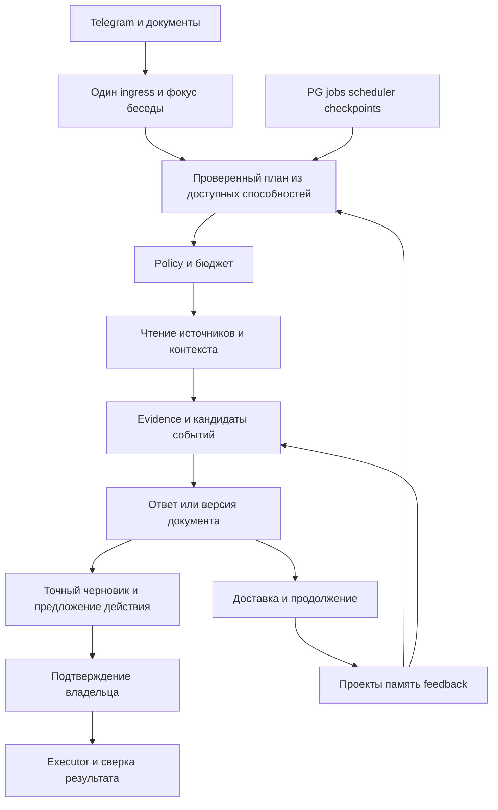

# Продуктовые и архитектурные решения

Предлагаемый дизайн на 11 октября 2026. Факты реализации и гипотезы разделены в [аудите](CODE_AUDIT.md). Все изменения ниже выполняются постепенно поверх существующего runtime. Новые названия типов и файлов — проектируемые интерфейсы, а не заявление об уже существующем коде.

## Один разговор с понятными результатами

Ассистент отвечает за завершение задачи: понять вопрос, получить разрешённый контекст, найти необходимое, объяснить результат, сохранить выбранное или подготовить действие. Chat/Search/Brief/Watch/Act остаются внутренними способностями. Пользователь видит предметные действия: «Объясни», «Проверь», «К моему проекту», «Сохранить», «Следить», «Подготовь ответ».

Первый запуск: короткий пример результата и три шага — выбрать интересующий проект/задачу, разрешённые материалы, стиль ответа. Подключать дополнительные аккаунты тогда, когда они нужны конкретной задаче. Возможность продолжить без аккаунтов должна быть явной. Согласование хранения и передачи данных помещается в один понятный экран с выбранными значениями; повторные чтения в этих пределах не требуют новых подтверждений.

### Основные цепочки

| Ситуация | Поведение и полезный результат |
| --- | --- |
| «Что изменилось в agent memory и что применить в проекте?» | Найти свежие первоисточники и мои ранее сохранённые материалы; прочитать выбранный ref проекта; дать 2–3 различия, применимость, один проверяемый эксперимент. Показать, где контекста проекта не хватило. |
| «Поясни второй пункт. Короче. А ограничения?» | Ссылка на exact result/version/item; объяснение по тем же источникам. «А сейчас это ещё верно?» запускает новое чтение и явно отделяет новое от исходного. |
| «Сохрани это к проекту» | Показать выбранный фрагмент и привязку; сохранить по явной недвусмысленной команде с отменой, если такая политика принята. При неоднозначности спросить о предмете. Существующий preview/confirm оставить до внедрения новой политики. |
| «Подготовь ответ автору письма» | Прочитать выбранную цепочку, разрешить реального адресата, создать локальный черновик. Изменение тона/адресата создаёт версию. Сохранение draft в почтовом аккаунте — отдельная запись. |
| «Следи за этим, только если выйдет стабильная версия» | Из текущего объекта заполнить критерий, источник, период, тихие часы и срок. Показать один preview, после подтверждения — реальное состояние и кнопку паузы. |
| «Что с моим исследованием? Стоп. Давай пока другое» | Статус из jobs/checkpoints; отменить выбранную задачу, освободить безопасно неиспользованный бюджет; продолжить другую беседу. Уже начатый внешний эффект остаётся в сверке. |
| Голосовое или PDF и «что из этого важно?» | Расшифровка/страницы становятся объектом той же беседы; можно исправить текст, спросить про страницу, сохранить вывод, подготовить черновик. |

Главный ответ: прямой вывод, необходимые основания, один уместный следующий шаг. Не все кнопки после каждой реплики. После простого Chat не навязывать поиск, сохранение и ежедневный отчёт. Вопрос задаётся только при существенной неоднозначности; безопасное чтение уже выбранного проекта выполняется самостоятельно.

### Продолжение и предмет разговора

Текущий объект определяется в порядке: явный Telegram reply/callback → явно названный документ/проект/задача → активная ветка беседы → один однозначный недавний объект. Несколько подходящих объектов дают компактный выбор по названиям. Глобального `last_result` недостаточно, особенно когда фоновое исследование завершилось между репликами.

`ConversationFocus` хранит thread ID, topic, project ref/version, активные result refs, pending proposal и jobs. `/new` или «новая тема» создаёт новый фокус; ранее сохранённые документы доступны по названию/времени. Возврат к старому результату не оживляет его истёкшие подтверждения. Сжатие истории хранит provenance и не становится источником адресата или срока действия.

Долгая задача имеет одну компактную карточку: принято → ищу → проверяю → собираю результат → готово/частично/остановлено/нужно решение. Проценты выводятся только при известном объёме. Редактирование карточки выполняется с rate limit и через существующий delivery ledger; если edit невозможен, один итоговый ответ. Status/cancel должны работать даже при отказе модели.

## Информация как помощь в решениях

### Отбор до генерации

Конвейер: selected source sync → нормализация и источники → группы событий → кандидаты по периоду/проекту → ранжирование → bounded evidence packet → редактура → проверка → сохранённый документ. Собрать 300 кандидатов детерминированно не означает отправить 300 текстов модели.

`SourceBatch` содержит items, source ref, cursor/continuation, checked_at, source watermark, completeness (`complete/partial/unavailable`), omitted count при известном числе, причину ограничения. Времена публикации, события и обнаружения различаются. Поле checked означает факт обращения, но не полноту недели. Большой источник не вытесняет все остальные: сначала per-source кандидаты, затем общая оценка с контролем разнообразия.

`EventCluster` объединяет перепечатки по canonical URL, нормализованному fingerprint и проверенной связи фактов. Сохраняет все source refs, первичный источник, противоречия и изменения. Несколько репостов не увеличивают количество независимых подтверждений. Не сливать события только по теме или похожему заголовку; изменение цены, версии или срока — новая ревизия события.

Начальное ранжирование объяснимо, без обучаемого профиля на пустом месте. Отдельные признаки: связь с подтверждённой текущей целью/блокером, достоверность, новизна для владельца, величина изменения, возможность применить, срочность, время чтения. Популярность канала и reactions — дополнительные признаки. Дедлайн не поднимается в обязательства без подтверждённого источника; новизна не доказывает полезность.

Предлагаемый алгоритм: обязательные проверенные изменения идут отдельно; остальные кандидаты сортируются по проектной применимости и новизне, затем выбираются с лимитом на тему/событие и бюджетом чтения. В первой версии веса фиксированы и версионированы; после 30–50 оценённых результатов сравнить с текущим baseline. Оставить небольшой блок «вне привычных тем» по желанию, чтобы персонализация не замкнулась на прошлых реакциях. Не вычислять фиктивную вероятность полезности из произвольных весов.

### Контекст проектов

Переиспользовать существующий project portfolio descriptor: название/aliases, цель, blocker, next proof, активность и разрешённые sources. Добавить version, reviewed_at, expires/recheck hint, связанные решения и эксперименты. Не копировать весь репозиторий в память. GitHub evidence привязан к commit SHA/path/строкам; изменение ref инвалидирует соответствующее предположение.

Предложение «применить» содержит: какой проект/цель, какое ограничение из проекта учтено, чем находка помогает, минимальный эксперимент, стоимость/сложность, условие отказа и ожидаемое доказательство. Если подтверждённого контекста нет — обозначить возможность и предложить привязку, не имитировать глубокую персонализацию.

### Недельный обзор

Первая карточка — 3–5 выводов за период и максимум одно актуальное обязательство/предупреждение; при пустой неделе короче. Полный документ по запросу: что изменилось → почему это важно для выбранных целей → что изучить/применить/пропустить → источники и ограничения. Не заполнять пустые рубрики и не выдавать план ассистента за обязательство владельца.

Каждый пункт имеет одно из продолжений: изучить для конкретного вопроса; проверить экспериментом; принять решение; проигнорировать до изменения условия. Никакого автоматического todo из каждой новости. «Пропустить» объясняет, что повторено или не относится к текущим целям; скрытая подборка доступна, но не создаёт счётчик долга.

Период по настройке: предыдущая календарная неделя либо последние семь дней, `[start,end)` и timezone. Сейчас runtime использует rolling seven days; calendar week нужно реализовать явно. Важное старое событие, обнаруженное сейчас, идёт с соответствующей подписью. «Что изменилось с прошлого обзора?» сравнивает event revisions, а не длины документов.

Сохранить `BriefDocument` как единственный источник для Telegram/HTML/PDF/Markdown. Изменение оформления не вызывает новую генерацию фактов. Действия из HTML возвращают conversation/object/version. Сначала доставлять текст и уже поддержанные документы; hosting reader развивается параллельно и не блокирует первый полезный текстовый обзор. Для полного VISUAL-02 нужен настоящий приватный мобильный reader, а не только локальный сервер.

### Память и обратная связь

Разделить историю беседы, подтверждённые факты/предпочтения, библиотеку сохранений, контекст проекта и производные данные источников. Общая система provenance/deletion обслуживает все эти типы. Сроки разных классов видны в настройках. Временный вывод из письма не становится бессрочным профилем.

Возможные реакции на результат: полезно; не моя тема; уже знал; слишком подробно; неверно; применил. «Не моя тема» снижает конкретную тему/связь с проектом, не все источники. Отсутствие реакции — unknown. Личная Telegram reaction остаётся позитивным сигналом интереса по существующему контракту. Открытие документа не означает прочтение, понимание или применение.

Автоматически записывать разрешённые interaction events и пересчитывать производный ranking можно в рамках выбранной политики; менять подтверждённую цель или долговременное предпочтение — по явному запросу либо preview. Пользователь видит «Почему это показано?» и может отменить правило. Недельный recap обратной связи — один короткий вопрос, не обязательная работа по разметке.

## Архитектура без перезапуска

**Предлагаемый выбор:** Python modular monolith, существующий PG runtime для состояния, SQLite для canonical Telegram archive, локальные private artifacts. Отдельные процессы ingress, compute и effects/scheduler нужны для отзывчивости и восстановления; это не набор микросервисов. У одного install-профиля один owner и один Telegram poller.

Новый `TaskPlan` — versioned JSON с intention, focus refs, required sources, list of typed steps, budgets, stop conditions и expected result type. Модель предлагает только зарегистрированные read/compose/draft/watch-preview способности. Код проверяет схему, права, допустимые переходы, ссылки и пределы. Confirmation/executor не доступны как свободный tool choice. Реальный effect создаётся только из существующего `ActionProposal` и действующего подтверждения.

Рекомендуемые минимальные DTO: `ConversationFocus`, `TaskPlan`, `SourceBatch`, `EvidenceBundle`, `EventCluster`, `ProjectContext`, `FeedbackEvent`, `TaskProgress`. Расширять нынешние contracts, где смысл совпадает; не дублировать `BriefDocument`, grants, jobs и actions. У всех производных объектов owner/source refs, version/hash и lineage. Внешняя оболочка получает безопасные DTO, SQL остаётся в repository.

### Сохранить, объединить, заменить

| Область | Решение и основание |
| --- | --- |
| Queue/recovery | Сохранить нынешние PG jobs, leases, fencing, separate effect attempts. Новая очередь не исправит product routing. Измерять lock wait и cancellation latency. |
| Canonical Telegram | Сохранить SQLite и IDs. В PG хранить metadata/refs и разрешённые derived objects. Не делать dual write полного архива. |
| Search | Свести legacy и durable callers к одному retrieval service, оставив совместимость. FTS остаётся baseline; learned embeddings/reranker проходят отдельный эксперимент. |
| Memory | Подключить явную память и project descriptor к context builder; не вводить отдельный Mem0/Zep сервис до измерения задачи, которую текущая схема не решает. |
| Model transport | Один policy-aware интерфейс с адаптерами Chat Completions, Responses, Messages по реальной потребности. Не распространять параметры одного API на все модели. |
| Brief | Сохранить document/render; заменить раннее `[:48]` на оценённую выборку с coverage; соединить editorial memory и feedback. |
| Routing | Постепенно заменить keyword branching на typed plan + deterministic controls. Сохранить команды как explicit adapter, не второй бизнес-путь. |
| Config/prompts | Typed config с schema/version и task profiles; prompts рядом с соответствующими use cases, version/hash в receipts. Секреты отдельно. |
| Read retries | Различать бесплатное безопасное чтение, оплачиваемую генерацию и внешний эффект. Bounded retry разрешён только классифицированным read; unknown cost остаётся записанным. Запрет повтора отправки сохраняется. |

### Готовые решения и цена замены

LangGraph действительно предоставляет thread checkpoints и long-term stores ([официальная документация](https://docs.langchain.com/oss/python/langgraph/persistence)). Здесь эти обязанности уже реализованы. Внедрение потребует адаптировать authority, deletion и unknown-effect semantics. Решение: не ставить в критический путь; отдельный spike только если собственный planner станет трудно поддерживать, с теми же сценариями и измерением объёма удалённого кода.

Temporal решает durable workflow, но требует учитывать идемпотентность activities ([документация](https://docs.temporal.io/activity-definition)). Он не превращает mail send в exactly-once. Для одного владельца сохранение PG проще; пересмотреть при измеренных проблемах восстановления/масштаба, не по числу задач в backlog.

MCP допустим как transport для выбранного read connector. Сервер получает конкретный allowlist и scopes, его ответ остаётся недоверенным; он не заменяет policy. Риски token passthrough и confused deputy описывает [официальная спецификация](https://modelcontextprotocol.io/docs/2026-07-28/tutorials/security/security_best_practices). Не подключать универсальный filesystem/shell или весь набор функций чужого сервера.

Готовые SDK OAuth/провайдеров и стандартные библиотеки извлечения документов предпочтительнее собственного протокольного кода, когда они уменьшают поверхность поддержки. Выбрать и pin после проверки нужных endpoint, retry поведения и логирования. Не добавлять одновременно LiteLLM, LangGraph, Temporal и n8n: такой стек создаст больше границ, чем уберёт. n8n оставить альтернативой для независимой ручной автоматизации, не вторым authority/executor ассистента.

## Подключения и реальные полномочия

| Источник | Первый полезный объём | Read / draft / act и проверка |
| --- | --- | --- |
| Telegram | Выбранные каналы/чаты либо импорт/пересылка; существующий ingestion с cursor и freshness. | Bot API вход не равен доступу к личной истории. Историю читает отдельно разрешённый collector/session. Egress корпуса ограничен выбранными фрагментами. Проверить edit/delete/reaction и source outage. |
| Веб/RSS | Brave discovery + безопасное чтение первоисточников; затем RSS выбранных сайтов как дешёвый incremental source. | Запрос публичный, без цитат из почты. Allowlist частных источников строгий; публичные домены можно расширять policy с SSRF/DNS/redirect guard. Сниппет не считается прочитанной страницей. |
| GitHub | Один выбранный repo, нужный ref, README/architecture/tasks; затем relevant issues/PR/releases. | Сначала public read; private через selected-repository read-only token/App. GitHub App поддерживает узкие repository permissions и short-lived tokens ([документация](https://docs.github.com/en/enterprise-cloud@latest/apps/creating-github-apps/about-creating-github-apps/deciding-when-to-build-a-github-app)). Права изменения кода не нужны. |
| Microsoft mail | Selected folder/window; metadata для triage, выбранные тела для ответа. | `Mail.ReadBasic` достаточен для message delta metadata; тела требуют соответствующего read scope. Delta идёт по папке ([Graph](https://learn.microsoft.com/en-us/graph/api/message-delta?view=graph-rest-1.0)). Фильтр приложения не сужает account token. Local draft без записи; provider draft/write/send раздельно. |
| Gmail | Только если выбран владельцем; тот же normalized mail contract. | `gmail.readonly`, `gmail.send`, `gmail.compose` различаются; compose включает отправку, а не только drafts ([scopes](https://developers.google.com/workspace/gmail/api/auth/scopes)). Не запрашивать modify ради чтения. Проверить refresh lifecycle конкретного OAuth режима. |
| Calendar/contacts | Выбранный календарь, окно событий, timezone, нужные контакты. | Читать schedule/free-busy отдельно от создания/изменения. Google предлагает отдельные read/freebusy/events scopes ([scopes](https://developers.google.com/workspace/calendar/api/auth)); конкретный scope определяется операцией. Проверить recurrence, DST, cancellation и конфликт версий. |
| Файлы | Пользовательский PDF/image, затем реально нужные docx/txt. | Text-first, page refs, size/time/type limits, sandbox extraction, удаление временного файла. Внешние OCR/vision/speech получают отдельный class/provider grant. |
| UTD Nebula | Отдельный GET adapter публичных данных, D51–D54; владелец запросит ключ. [Контракт и upstream audit](UTD_NEBULA.md). | Nebula-only работает без Canvas. Даты агрегатора требуют precision/session и primary verification для срочных решений. Полноценная интеграция включает durable sync/recovery и 14-дневный пилот; api-tools/иной готовый компонент выбирается в D55 при измеренном пробеле, без искусственного требования минимизировать код. |
| Canvas | Личные assignments/announcements/calendar остаются отключены до разрешённого доступа, D41. | Deadline conflicts и local done/source confirmed сохраняются. Общий Academic coordinator работает и с выбранной почтой или Nebula; отсрочка Canvas их не выключает. |

Connection lifecycle: selected → consent pending → connected → syncing → ready/partial → expired/revoked → deletion pending/complete. На домашнем статусе показывать последнюю успешную проверку и неполноту, не OAuth термины. Один отдельный failure не обнуляет ответ из остальных источников.

Подтверждение действия: account, recipient/object, content/time/timezone, attachments/invite consequences, version, expiry. Отредактированный draft аннулирует старое подтверждение. Graph `202 Accepted` не доказывает завершённую отправку ([sendMail](https://learn.microsoft.com/en-us/graph/api/user-sendmail?view=graph-rest-1.0)); сверять точный provider object, не повторять вслепую. Доставлено получателю — отдельное наблюдение, обычно неизвестное. Команда «стоп» прекращает будущие эффекты, не объявляет уже отправленное письмо отменённым.

## Хранение, запуск и поддержка

Новый private target обязан иметь явную идентичность БД/окружения, отдельные app/migrator roles, проверенную аутентификацию, loopback/Unix socket или TLS согласно размещению, секреты вне репозитория, versioned migrations и безопасную диагностику. `SyntheticTarget` остаётся отдельным строгим типом. Test DDL hashes не переписывать ради private roles; вводить новую последовательность миграций с явной совместимостью.

Для старта: preflight schema/config/capabilities → restore rehearsal на копии → read canary → foreground session → только затем согласованные процессы и расписания. Production не стартует на import/help/config validation. Не выводить DSN/token/account ID в логи и общедоступный receipt. Rollback блокирует старую версию приложения, если она не умеет прочитать новую схему/receipt; не восстанавливать backup так, чтобы повторить consumed effect или воскресить revoked grant.

Предлагаемые сроки настройки: история 30 дней; temp uploads до обработки и короткого cleanup deadline; исходные connector тела минимально необходимое время; explicit memory до удаления; backups по выбранному сроку. Это варианты, требующие выбора до личного сохранения. Retention должна включать артефакты, индексы, traces и провайдерские ограничения.

Метрики: возраст необработанной задачи; last successful source sync; p50/p95 queue/runtime/cancel; unknown actions; provider errors; invalid citations; доля полезных результатов; обычные уведомления/день; стоимость успешной задачи. Один operator status, один kill switch. Не требовать внешнего observability SaaS для первого пилота.

## Что защищает, а что мешает

| Сохранить как инвариант | Упростить как исторический процесс |
| --- | --- |
| Отдельные read/write/egress/background grants; exact owner/version confirmation. | Один актуальный handoff вместо повторения разрешений и огромных хронологий в каждом документе. |
| Secret isolation, network guard, source lineage, retention/revoke, unknown-effect ledger. | Один принятый дизайн и delta reviews по риску вместо перезапуска полного program review из-за редакционной правки. |
| Canonical archive и проверенная миграция/restore. | Изменения wording/CSS не требуют такого же review, как OAuth или send executor. |
| Независимое ревью security/effects; P0/P1 recheck до зависимой работы. | Имена reviewer models, численные лимиты и failed calls вынести из действующей нормативной политики в profile/receipts. |
| Честное различение test/provider/operator/formal acceptance. | Генерировать повторяющиеся task tables из одного реестра; документы статуса ссылаются на receipt, не копируют всё. |
| Работа в ветке, history-preserving integration, scoped tests. | Удалять необслуживаемые compatibility paths только после подтверждения маршрутов; не делать их вечной обязательной средой для нового продукта. |

Упрощение не означает подделать 51 missing approvals или отменить безопасность. D48 готовит новую короткую policy и формальное отображение старых статусов в актуальные; до её принятия действующий workflow остаётся действующим. Локальная разработка по назначенному блоку продолжается в уже разрешённых границах.

## Telegram: уточнение общей архитектуры от 11 октября

[Официальный контракт и кодовые наблюдения](TELEGRAM.md) обосновывают D56–D62 в общем backlog. Существующий urllib Bot API transport расширяется typed envelope/route/bindings; Telethon collector остаётся отдельным источником. D56 устраняет потерю reply/quote/thread и navigation, D57 проецирует durable worker progress в status/draft/Stop, D58 рендерит тот же BriefDocument в native rich blocks. Ephemeral preview не заменяет durable final delivery; unknown outcome не допускает повтор другой формой.

Темы D59 требуют изолированных conversation keys и измеренного выигрыша, но не создают новый режим ассистента. Secretary D60 — новый ограниченный источник входящих, D61 — owner-only triage/черновики, D62 — отдельный confirmed effect adapter. Содержимое переписки не даёт прав на действия или раскрытие других источников. Mini App исключён владельцем. D25 — обычный приватный reader, D58 — нативные отчёты Telegram; второй document backend не создаётся. Новых независимых фаз/процессов разработки это дополнение не вводит; порядок и gates находятся в общей DAG.
